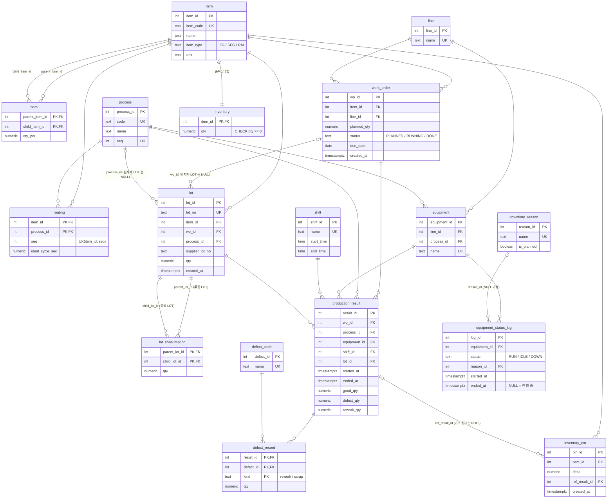

# ERD 와 지표 정의

가상의 전자부품 공장(SMT/조립 라인) 데이터 모델. 테이블 17개, 정의는 [`sql/01_schema.sql`](../sql/01_schema.sql).
모든 데이터는 가상이다.

## ERD

### 읽는 법
- **마스터**: `item`, `bom`, `process`, `routing`, `line`, `equipment`, `shift`, `downtime_reason`, `defect_code`
- **트랜잭션**: `work_order`, `lot`, `lot_consumption`, `production_result`, `defect_record`, `equipment_status_log`, `inventory`, `inventory_txn`
- `bom`: FG → SFG → RM 2단계 (시드: 완제품 3, 반제품 2, 원자재 5).
- `routing`: 품목별 공정 순서와 `ideal_cycle_sec`(개당 이상 사이클타임). 시드에서 SFG 는 자재투입→SMT→AOI검사(8–12초), FG 는 조립→기능검사→포장(16–30초). 같은 품목의 공정별 사이클은 비슷하게 맞추고 SMT·조립을 약간 느린 병목으로 두었다(라인 밸런싱).
- `lot_consumption`: `parent_lot_id` 가 투입된 LOT, `child_lot_id` 가 만들어진 LOT 인 계보 테이블 (LOT 추적의 간선).
- `lot`: 원자재 입고 LOT 는 `wo_id`/`process_id` 가 NULL 이고 `supplier_lot_no` 를 가진다.
- 시드 규모: 설비 12대 (라인 2 x 공정 6), 교대 2개 ([`sql/02_seed.sql`](../sql/02_seed.sql)).
- 조회용 인덱스 5개: `production_result(equipment_id, started_at)`, `production_result(wo_id)`, `lot_consumption(parent_lot_id)`, `lot_consumption(child_lot_id)`, `equipment_status_log(equipment_id, started_at)`.
- 무결성 인덱스: `ux_equipment_status_log_one_open` — `equipment_status_log(equipment_id) WHERE ended_at IS NULL` 부분 유니크 인덱스. 설비당 진행 중 상태 로그는 최대 1개.
- 설비 시드는 라인 → 공정 순서(`ORDER BY line, process.seq`)로 넣어 `equipment_id` 가 공정 흐름 순서를 따른다 (L1-자재투입기 = 첫 번째).

## 지표 정의

지표는 모두 SQL(뷰/함수/트리거)에서 계산한다. FastAPI 와 React 화면은 결과를 읽어 표시하기만 한다.
구현: [`sql/03_functions_triggers.sql`](../sql/03_functions_triggers.sql), [`sql/04_views.sql`](../sql/04_views.sql).

### OEE (`v_oee_daily`)
행 단위는 **설비 x 교대 x work_date**. 생산실적 또는 설비 상태 로그 활동이 있는 조합만 행으로 나온다.

| 요소 | 정의 |
|---|---|
| 가동률 (availability) | `가동시간 / 계획시간`, 최대 1로 캡 (`LEAST(1, ...)`) |
| 성능률 (performance) | `Σ(ideal_cycle_sec x (양품+불량)) / 가동시간(초)`, 상한 캡 없음 |
| 품질률 (quality) | `양품 / (양품+불량)`, 생산수량 0 이면 NULL |
| OEE | `가동률 x 성능률 x COALESCE(품질률, 0)` |

- **유효 창**: 교대 창 `[교대 시작, 교대 끝]` 을 `now()` 에서 자른 `[교대 시작, LEAST(교대 끝, now())]`. 이미 끝난 교대는 교대 창 그대로, 진행 중인 교대는 지금까지의 구간만 본다.
- **가동시간**: `RUN` 상태 로그가 유효 창과 겹치는 시간의 합. `ended_at IS NULL`(진행 중)은 `now()` 까지. 교대 경계를 걸치는 로그는 교대별로 잘라 계산한다.
- **계획시간**: `유효 창 길이 - 계획 비가동`. 계획 비가동은 `downtime_reason.is_planned = true` 사유가 붙은 비-RUN 로그의 유효 창 내 겹침 시간이다(점심, 정기점검). 비계획 정지(설비고장, 자재대기)와 사유 없는 IDLE 은 계획시간에서 빼지 않으므로 가동률을 낮춘다.
- **이상 사이클타임**: 작업지시 품목과 설비 공정의 `routing.ideal_cycle_sec`. 라우팅에 없으면 기여 0.
- **품질률 NULL**: 상태 로그만 있고 실적이 없는 행은 품질률이 정의되지 않으므로 NULL (평균 품질률을 0 으로 끌어내리지 않음). 이때 성능률은 0 이므로 OEE 는 0.
- **그 밖에 분모가 0이면** 해당 비율은 0 (`NULLIF`/`COALESCE`), 오류 없음.
- **교대와 work_date 규칙**: 시드의 주간 08:00–20:00, 야간 20:00–08:00. `work_date` 는 교대가 **시작한** 달력 날짜다. 야간조의 자정 이후 구간(00:00–08:00)은 전날 `work_date` 에 속한다. 교대 창은 `work_date + start_time` 부터 교대길이(12시간)이며 `end_time <= start_time` 이면 익일로 넘어간다. 뷰의 `shift_start`/`shift_end` 열이 교대 창(캡 적용 전)이다.
- **시간대**: 날짜/시각 변환은 세션 `TimeZone` 기준이며, `mes.db.connect()` 가 세션마다 `Asia/Seoul` 로 고정한다(서버·Docker 기본값 UTC 와 무관). `scripts/create_dbs.sql` 과 Docker 초기화 스크립트도 DB 기본 시간대를 `Asia/Seoul` 로 둔다.
- **대시보드 집계 범위**: 웹 대시보드(`backend/app/routers/read.py` 의 `RECENT_OEE`)의 KPI 카드 평균 OEE 와 설비별 OEE 차트는 `shift_end > max(shift_end) - 24시간`, 즉 데이터가 있는 최근 2개 교대 창의 행 평균이다.

### 불량률과 FTY (`v_defect_rate`)
- 공정별: `input_qty = 양품+불량`, `defect_rate = 불량 / 투입` (투입 0 이면 0).
- `scrap_qty`, `rework_qty` 는 `defect_record.kind` 별 합계.
- **FTY(First Time Yield)** = 투입이 있는 모든 공정의 `양품/(양품+불량)` 의 곱. 전체 공정에 대한 단일 값이라 각 행에 같은 값이 반복된다. 투입 없는 공정은 곱에서 제외하고, 투입이 있는 공정 중 양품 0 인 곳이 있으면 FTY 는 0.
- 시드의 공정은 6개이지만 공정별 합산 기준이라, SFG 와 FG 라우팅이 서로 다른 공정을 쓰는데도 FTY 는 6개 공정 전부의 곱이다. 즉 한 제품의 실제 경로 수율이 아니라 공장 전체 공정 수율의 곱이다.
- 웹 대시보드의 "불량률"(`/api/kpi`)은 `sum(defect_qty) / sum(input_qty)` (공정 합산 풀링 비율)이다.

### 작업지시 진행률 (`v_wo_progress`)
`progress_pct = 100 x 마지막 공정 누적 양품 / planned_qty` (소수 1자리). "마지막 공정"은 해당 품목 `routing` 에서 `seq` 가 가장 큰 공정이다.

### 재고 backflush (트리거 `trg_production_result_ai`)
`production_result` INSERT 시 실행된다. 규칙은 단순화되어 있다.
- **첫 공정**(품목 라우팅의 최소 `seq`, `routing_position` 이 FIRST/BOTH)의 실적에서만 BOM **직계 자식**을 `qty_per x (양품+불량)` 만큼 차감한다 (`inventory_txn.delta` 음수).
- **마지막 공정**(LAST/BOTH)의 실적에서만 생산 품목 재고를 `양품` 만큼 증가시킨다 (delta 양수).
- 중간 공정은 재고 이동 없이 실적만 기록한다.
- 재고 부족은 `inventory.qty >= 0` CHECK 위반으로 드러나 해당 INSERT 전체가 롤백된다.
- 품목의 재고 행이 없으면(UPDATE 0행) `재고 행이 없습니다` 예외로 INSERT 전체를 거부한다. 원장(`inventory_txn`)만 쌓이고 잔고가 어긋나는 일을 막는다.
- 작업지시 상태: 첫 실적에서 `PLANNED → RUNNING`, 마지막 공정 누적 양품이 계획 이상이면 `DONE`.
- 초과생산 방지(`trg_production_result_bi`, BEFORE INSERT): 마지막 공정의 누적 양품 + 신규 양품이 `planned_qty` 를 넘으면 예외. 같은 작업지시 행을 `FOR UPDATE` 로 잠가 동시 입력의 경쟁 상태를 막는다.

### LOT 추적 (`trace_forward`, `trace_backward`)
`lot_consumption` 을 `WITH RECURSIVE` 로 따라간다.
- `trace_forward(lot_no)`: 해당 LOT 를 투입해 만들어진 모든 하위 LOT. 반환 `(lot_no, item_code, depth)`.
- `trace_backward(lot_no)`: 해당 LOT 를 만들 때 투입된 상위 LOT (원자재 LOT 포함). 반환 `(lot_no, item_code, supplier_lot_no, depth)`.
- 시작 LOT 는 결과에서 제외, `depth` 는 1부터.
- 여러 경로로 도달하는 LOT 는 **최소 depth** 로 한 번만 반환 (`DISTINCT ON (lot_id) ... ORDER BY lot_id, depth`).
- **순환 방지**: 방문 경로를 배열(`path`)로 들고 다니며 이미 방문한 LOT 는 재방문하지 않는다 (`child_lot_id <> ALL(path)`). 순환 데이터가 있어도 종료한다 (`tests/test_lot_trace.py::test_cycle_does_not_hang`).
- 없는 `lot_no` 는 0행.

### 시뮬레이터가 만드는 계보
시뮬레이터는 실적마다 실제 투입량(`(양품+불량) x qty_per`)을 잔량이 있는 LOT 에 **선입선출(FIFO)** 로 할당하고, 할당량을 `lot_consumption.qty` 로 기록한다. 어떤 LOT 도 자기 수량(`lot.qty` = 양품)보다 많이 투입되지 않는다.
- **첫 공정의 반제품 투입**(완제품 조립): 그 반제품 품목 라우팅의 **마지막 공정**(AOI 검사)을 통과한 LOT 만 투입한다. 자재투입·SMT 단계의 미검사 LOT 는 연결되지 않는다.
- **첫 공정의 원자재 투입**: 공급사 LOT(`<품목코드>-<순번 4자리>`, 예 `RM-IC-0001`, 1만 개 단위, `supplier_lot_no` 보유, `wo_id` NULL)를 여러 작업지시가 나눠 쓰고, 잔량이 모자라면 새 공급사 LOT 를 만든다.
- **이후 공정**: 같은 작업지시의 바로 앞 공정 LOT.
- **웹에서 수동 입력한 실적**(`POST /api/results`, `backend/app/services/results.py`)도 같은 계보 규칙을 쓴다. LOT 번호는 `WO-<작업지시>-<공정코드>-M<순번>` 이며 `M` 접두사로 시뮬레이터의 순번(`WO-<작업지시>-<공정코드>-<순번>`)과 구분한다. 한 실적에 LOT 하나를 만들고(`lot.qty` = 양품), 시각은 서버 현재 시각(KST) 기준이며 시작 시각은 입력한 소요 시간(분)으로 계산한다. 교대는 종료 시각의 교대로 귀속하고 경계에서 실적을 나누지 않는다(시뮬레이터는 나눈다). 불량 내역은 `(불량코드, 구분)`별로 합산해 `defect_record` 에 넣고 `defect_qty`(재작업+폐기)와 `rework_qty` 를 같은 합계로 저장한다.
- `tests/test_simulator.py::test_lot_genealogy_follows_routing` 이 위 규칙을 검증한다. 실제 바코드 투입 실적이 아니라 규칙으로 만든 계보이며, 원자재 LOT 는 계보용이고 재고 수량과는 별도다.

### 시뮬레이터 동작 모델 (요약)
- 일감(작업지시 투입 가능 수량: 첫 공정은 계획 x 115%와 BOM 재고, 후공정은 전공정 재공, 마지막 공정은 계획 잔량)이 없으면 설비는 RUN 이 아니라 **IDLE(자재대기, 비계획)** 로 기록되고, 일감이 생기면 바로 RUN 으로 돌아간다. 틱 도중 일감이 떨어지면 그 시각에 RUN 을 끝낸다.
- 라인마다 SFG 작업지시와 FG 작업지시를 하나 이상 유지한다(두 라우팅의 공정이 겹치지 않으므로). 반제품 품목은 재고 + 진행 중 계획수량이 적은 것을 고른다.
- 고장·순간정지·정기점검·점심은 시간당 발생률로 정의해 틱 길이(60초/600초)와 무관하게 같은 빈도로 일어난다.
- 불량률은 검사 공정(AOI 4–7%, 기능검사 4–7%)에 집중되고 나머지 공정은 0.2–3% 이다.
- 틱이 교대 경계를 걸치면 실적을 경계에서 나눈다(실적의 교대 = 실적 시작 시각의 교대).
- 작업지시의 `created_at`/`due_date` 는 시뮬 시각 기준이다. 시뮬 시각은 현재 시각을 넘지 않는다(README 의 시계 규칙).

### 그 외 규칙
- 설비 12대 모두 라인 x 공정 조합으로 하나씩 존재 (`tests/test_schema.py` 로 검증).
- 재고는 단일 창고, 품목당 1행. 원자재 초기 재고 1,000,000 은 수불 원장에 기초 입고로 기록된다.
- 시뮬레이터의 원자재 보충(`replenish`)은 재고가 20,000 미만이면 500,000 입고 (트리거와 별개의 시뮬레이터 동작).
